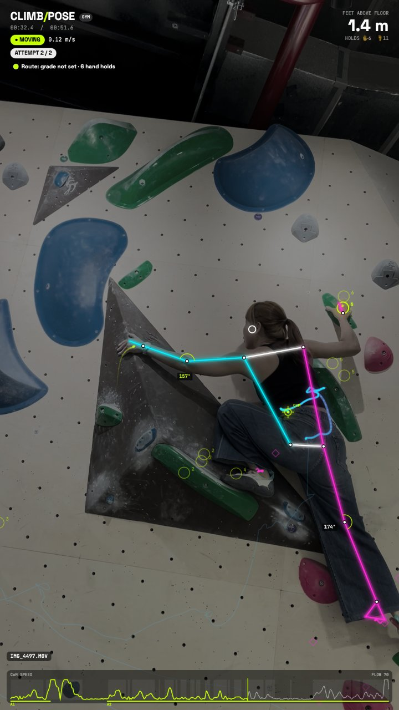
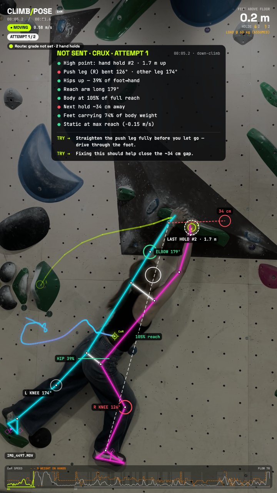
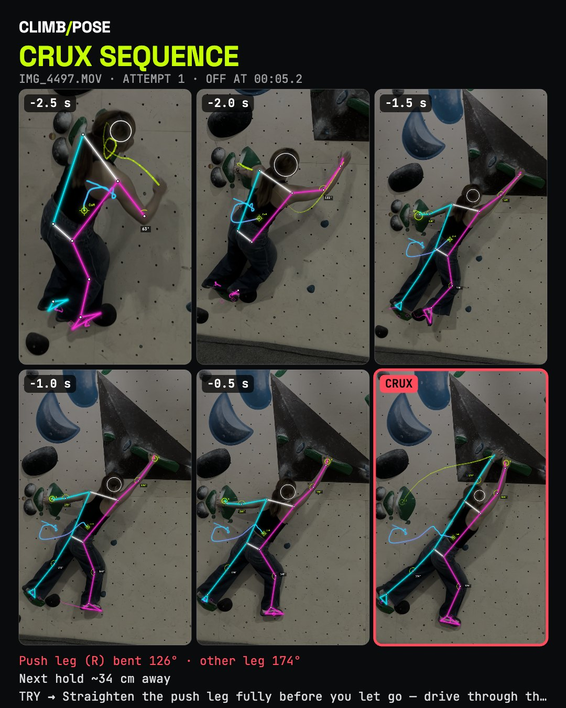

# CLIMB/POSE

Pose analysis for climbing videos. It runs in your browser, and the video stays on your device.

**Try it:** https://peckkie.github.io/climbpose-lab/

<table>
<tr>
<td width="31%"></td>
<td width="31%"></td>
<td width="38%"></td>
</tr>
<tr>
<td align="center"><sub>The climb with skeleton, holds and CoM trail</sub></td>
<td align="center"><sub>The frame before coming off</sub></td>
<td align="center"><sub>Crux sequence, sized for Instagram</sub></td>
</tr>
</table>

Most climbing clips get watched once and forgotten. The interesting one is usually the attempt
that didn't go. This app takes a phone video of a boulder or a gym problem and shows what the body
was doing at the moment it went wrong: where the hips were, which leg was pushing, how far the
next hold was.

## What you get

Drop in a video, enter the climber's height, press **Analyze climb**. After that:

- **The climb drawn over the video.** Skeleton, centre-of-mass trail, hand and foot trails, joint
  angles and the holds it found. Three looks (Neon, Chalk, Thermal). The camera can be handheld:
  the overlay is locked to the wall, not the screen.
- **Attempts, counted.** Each one is marked sent or not sent. For a fail you also get the high
  point and the last hold. You can override the result if it guessed wrong.
- **The crux.** For every attempt that didn't go, it finds the frame just before coming off and
  checks the push leg, hip height, reaching arm and the gap to the next hold. Then it gives up to
  three things to try. *Sequence image* turns the last 2.5 s into one 6-frame picture.
- **Body load** (if you enter body weight). How much weight is on the hands vs the feet, and the
  torque at shoulders, elbows, hips and knees.
- **The other attempt as a ghost.** Switch it on to see the sent attempt drawn faintly over the
  failed one, at the same height on the wall.
- **History.** Save a session with the route (gym, grade, tag colour, name). Later sessions on the
  same route show the change in Flow, % on hands and crux gap. *Progress* plots it over time.
  Sessions can be exported as a small `.climbpose.json` file and imported on another device.
- **Exports.** MP4 with the overlay (original frame, or 9:16 with a follow cam), per-frame CSV and
  a summary JSON.

The UI is in English and Thai, and works on a phone.

## Filming

The analysis is only as good as the clip. The short version: tripod or a steady hand, the whole
climber in frame from start to finish, side-on or straight on, decent light, nobody else on the
wall. The in-app **Filming guide** has the details, and the quality warnings after an analysis
link to the tip that fixes each problem.

## How accurate is it

Honestly, not proven yet. On the clips we have hand-labelled (3 clips, 4 attempts), it finds every
attempt, gets every start and end within 0.7 s (about 0.26 s on average) and gets sent / not sent
right every time. That is a small set. The thresholds for the crux checks are a first guess and
will change once climbers and coaches have looked at more results.

Things to keep in mind:

- It is one camera and 2D. Distances are scaled from the climber's height, so they are rough,
  and they only make sense near the wall.
- Comparing the same climber on the same problem over time is what it does best. Comparing two
  different people is not very meaningful.
- The Flow score (35% smoothness, 25% path, 25% straight arms, 15% footwork) is our own heuristic.
  Nobody has validated it.
- Body load assumes the climber is mostly still. Dynos and catches are underestimated.
- If the climber fills the whole frame, the camera tracker loses the wall and the overlay drifts.
- Left and right can still swap when the hips are side-on to the camera.
- Video URLs need CORS and range requests. Local files always work.

## Privacy

Nothing is uploaded. The video is read by the browser, the pose model runs on your device, and
saved sessions live in the browser's storage. The page loads the MediaPipe model from jsDelivr
and fonts from Google Fonts, and that is all it fetches. More in **About & privacy** in the app.

## Running it yourself

```bash
npm install
npm run dev
```

The dev server is at http://localhost:5173. Other commands:

```bash
npm run build          # static site in dist/
npm run build:single   # one HTML file in dist-single/, opens with a double-click
npm test               # unit tests + regression checks on every fixture
npm run eval           # accuracy against hand labels, report in tests/eval/last-report.json
npm run typecheck
npm run lint:layers    # core must not touch the DOM or import upper layers
```

It is Vite + TypeScript. MediaPipe Pose Landmarker runs in a Web Worker, camera tracking in a
second one. How the modules fit together is in [docs/ARCHITECTURE.md](docs/ARCHITECTURE.md), what
is done and what is next is in [docs/ROADMAP.md](docs/ROADMAP.md), and
[CONTRIBUTING.md](CONTRIBUTING.md) covers branches, test data and labelling.

**Changing the analysis on purpose?** Run `npm run golden:update`, read the diff of the
`*.golden.json` files and the eval report, and commit them with the code.

**Adding a test clip:** analyse it, press *Pose fixture (dev)*, put the `.pose.json` in
`tests/fixtures/` (or `tests/fixtures/local/` if it can't be shared) and run
`npm run golden:update`. To label it, open the **Label** card and mark start, end, sent, crux and
last hold with the keys shown there. Videos never go in the repo.

<details>
<summary><b>How the numbers are worked out</b></summary>

### Metrics

| Metric | What it is |
|---|---|
| Attempt | Starts when a hand is above chest height and both feet leave the floor at the wall base; lasts while the feet stay up (at least 1.5 s). Ends in a fall or jump-off if the CoM drops faster than 1.2 m/s |
| Sent | Both hands matched on the top hold for 1 s (gym), or a top-out (rock) |
| Fluency (LDLJ) | Log dimensionless jerk of the CoM per move. Closer to 0 is smoother |
| Path entropy (GIE) | log₂(2L / hull perimeter) of the CoM path (Cordier, Seifert). Lower is more direct |
| Straight-arm rest | Share of still time with an elbow over 150° |
| Foot : hand | Foot placements per hand grab |
| Move / rest | Share of time on the wall spent moving vs still |

Scale comes from trunk length ≈ 0.29 × height.

### Crux checks

| Check | Flagged when |
|---|---|
| Push leg knee angle | under 155°, leg not fully driven |
| Hip height, as % of the foot-to-hand span | under 38%, hips low |
| Reaching elbow | under 150°, arm bent |
| Body extension, foot-to-hand over full reach | under 88% |
| Gap to the nearest hand hold above | always shown, in cm |
| CoM vertical speed | over 0.25 m/s counts as dynamic |

### Body load

Still hands and feet count as supports. Body weight is split between them by solving 2D statics:
the forces have to add up to the weight and balance the torque about the CoM, with the feet
preferred. On overhangs the part pulling away from the wall goes to the hands.

### Gym or rock

Auto-detect looks at three frames. Gym walls are big smooth panels with bright plastic holds; rock
is textured everywhere, with duller colours and plants. You can also pick it yourself. On rock
there is no tag colour, and a send means a top-out.

</details>

## Credits

The idea of looking hardest at the failed attempt came from a V8 climber. Background reading:

- Beltrán et al., *Climbing Technique Evaluation by Means of Skeleton Video Stream Analysis*,
  Sensors 23(19) 8216, 2023
- arXiv 2505.12854
- Seifert, Cordier and others on the geometric index of entropy for climbing fluency

Pose estimation is [MediaPipe Pose Landmarker](https://ai.google.dev/edge/mediapipe/solutions/vision/pose_landmarker).
