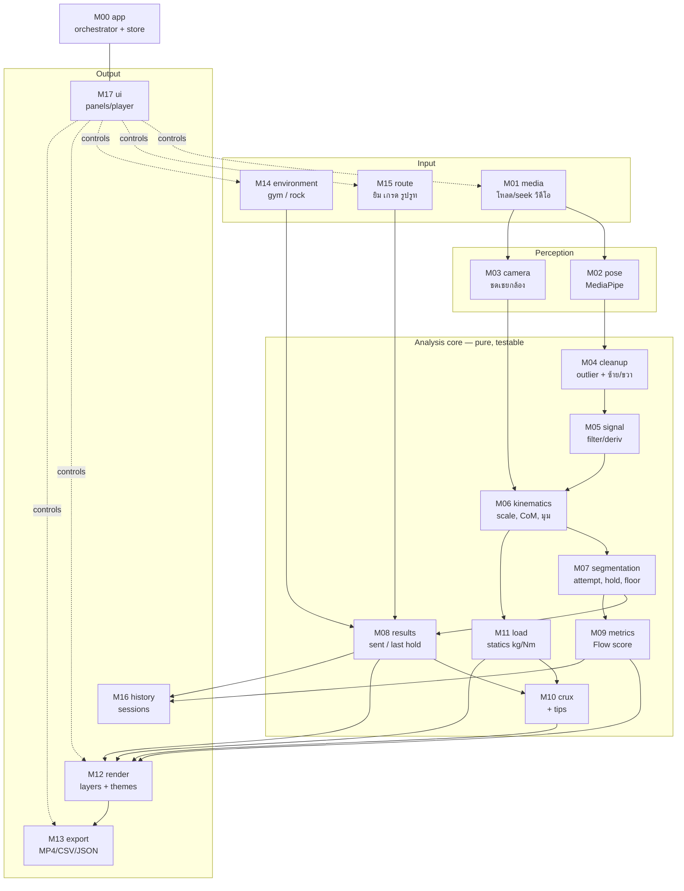
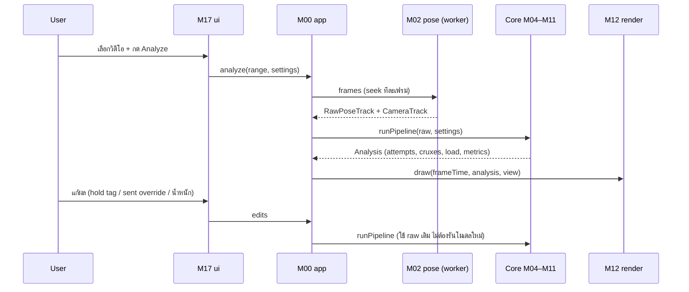

# ClimbPose Lab — Architecture

> สถาปัตยกรรมเป้าหมายของ ClimbPose Lab (repo: `Peckkie/climbpose-lab`)
> สถานะปัจจุบัน: v0.2 เป็นไฟล์เดียว `index.html` (1,565 บรรทัด) ทุกอย่างอยู่ในไฟล์นี้และใช้ state กลาง `S` ร่วมกัน
> เอกสารนี้แบ่งแอปเป็นโมดูล กำหนดข้อมูลที่ส่งต่อระหว่างโมดูล และบอกว่าโค้ดเดิมส่วนไหนย้ายไปอยู่ที่ไหน
> แผนการพัฒนาทีละเฟสอยู่ใน [ROADMAP.md](ROADMAP.md)

---

## 1. หลักการออกแบบ

1. **วิดีโอไม่ออกจากเครื่อง** — ประมวลผลในเบราว์เซอร์ทั้งหมด ไม่มีเซิร์ฟเวอร์รับคลิป เป็นจุดต่างหลักจากแอปคู่แข่ง (เช่น Cruxie ที่อัปโหลดขึ้นเซิร์ฟเวอร์)
2. **แกนวิเคราะห์เป็น pure function** — รับข้อมูลเข้า คืนข้อมูลออก ไม่แตะ DOM ไม่อ่าน state กลาง จึงทดสอบใน Node ได้ด้วยข้อมูลท่าทางที่บันทึกไว้ (fixture) โดยไม่ต้องรันโมเดลซ้ำ
3. **ทุกเกณฑ์ตัวเลขอยู่ที่เดียว** (`config`) — เช่น เข่า < 155° = ถีบไม่สุด จะปรับตามฟีดแบ็กนักปีนได้โดยไม่ต้องไล่หาในโค้ด
4. **ไหลทางเดียว** — วิดีโอ → ท่าทางดิบ → ท่าทางที่ทำความสะอาดแล้ว → kinematics → การแบ่งช่วง (attempt/hold/send) → ผลวิเคราะห์ → ภาพ/ไฟล์ส่งออก โมดูลชั้นล่างไม่รู้จักชั้นบน
5. **ค่าที่ไม่แน่นอนต้องบอกผู้ใช้** — ค่าที่ประมาณ (น้ำหนักสมมติ, ผลส่ง/ไม่ส่งอัตโนมัติ, เกรดที่ไม่ได้กรอก) ต้องมีป้ายกำกับและแก้เองได้เสมอ
6. **ยังเปิดได้โดยไม่ต้องติดตั้ง** — build ออกมาเป็นเว็บ static และมีตัวเลือก build เป็นไฟล์ HTML เดียวที่ดับเบิลคลิกเปิดได้เหมือนเดิม

---

## 2. ภาพรวมระบบ



ลำดับการทำงานหลัก:



---

## 3. โครงสร้างไฟล์เป้าหมาย

```
climbpose-lab/
├─ index.html                 # shell: layout + <script type="module" src="src/main.ts">
├─ src/
│  ├─ main.ts                 # M00 bootstrap
│  ├─ app/                    # M00 orchestrator, store, events
│  ├─ media/                  # M01
│  ├─ pose/                   # M02 (+ pose.worker.ts)
│  ├─ camera/                 # M03
│  ├─ core/                   # M04–M11 — ห้าม import DOM
│  │  ├─ cleanup/  signal/  kinematics/  segmentation/
│  │  ├─ results/  metrics/  crux/  load/
│  │  └─ pipeline.ts          # runPipeline(raw, settings) → Analysis
│  ├─ render/                 # M12 layers.ts (LAYERS list), hud, overlays, endcards, style, draw
│  ├─ export/                 # M13 files.ts, video.ts (timeline segments)
│  ├─ environment/            # M14
│  ├─ route/                  # M15
│  ├─ history/                # M16
│  ├─ labeling/               # ป้ายจริง (*.labels.json) + เทียบกับผล (ใช้ทั้งแอปและ eval)
│  ├─ ui/                     # M17 *-panel.ts, stats, player, tagging, dom
│  ├─ util/                   # fmt, lerp (ชั้น 0, ไม่มี DOM)
│  ├─ config.ts               # เกณฑ์ตัวเลขทั้งหมด
│  ├─ coaching.ts             # ข้อความ cue/tip ของ crux (ไทย/อังกฤษ) — แก้ถ้อยคำที่นี่
│  └─ types.ts                # data contracts (หัวข้อ 5)
├─ tests/
│  ├─ fixtures/               # *.pose.json (ท่าทางดิบที่บันทึกไว้) + *.labels.json (ค่าจริงที่ติดป้ายเอง)
│  ├─ unit/                   # vitest ต่อโมดูล core
│  └─ eval/                   # สคริปต์วัดความแม่นยำกับ labels
├─ tools/
│  └─ dump-fixture.html       # หน้าสำหรับรันโมเดลแล้วบันทึก raw pose เป็น fixture
├─ docs/  ARCHITECTURE.md  ROADMAP.md
└─ .gitignore                 # *.MOV *.mp4 results/ (วิดีโอไม่เข้า repo)
```

เครื่องมือ: **Vite + TypeScript** (build เป็น static), **Vitest** สำหรับ unit test, `vite-plugin-singlefile` สำหรับ build แบบไฟล์เดียว, MediaPipe และ mp4-muxer ผ่าน npm แทน CDN (ล็อกเวอร์ชันใน `package-lock.json`)

---

## 4. รายละเอียดโมดูล

แต่ละโมดูลระบุ: หน้าที่ · API สาธารณะ · รับ/ส่งข้อมูล · โค้ดเดิมที่ย้ายมา · ความเสี่ยงหรือหมายเหตุ

### M00 · app — orchestrator และ state

- **หน้าที่:** เป็นที่เดียวที่เชื่อมโมดูลทั้งหมด เก็บ state ของแอป ส่ง event ให้ UI
- **API:** `createStore()` (state + subscribe), `analyze(opts)`, `reprocess()` (รัน core ใหม่จาก raw เดิม), `setEdits(edits)`
- **State แยกเป็นก้อน:** `source` (ไฟล์/วิดีโอ), `settings` (ส่วนสูง น้ำหนัก มุมผนัง fps โมเดล), `route` (RouteInfo), `edits` (hold tag, sent override), `raw` (RawPoseTrack + CameraTrack), `analysis` (ผล core), `view` (สไตล์ กรอบ ซูม toggle)
- **กติกา:** core ได้รับ `raw + settings + route + edits` เป็นอาร์กิวเมนต์เท่านั้น ห้ามอ่าน store เอง
- **โค้ดเดิม:** object `S`, `process()` ส่วนเรียกลำดับ, `S.reprocess`, `lockUI`
- **หมายเหตุ:** cache ผลแต่ละขั้น (เช่น cleanup) ด้วย key จาก input เพื่อให้แก้ผลแล้ว reprocess เร็ว (ตอนนี้ใช้ `R0.clean`/`R0.lr` แบบ ad-hoc)

### M01 · media — วิดีโอ

- **หน้าที่:** โหลดไฟล์/URL, อ่าน metadata (ขนาดหลังหมุน, ความยาว), seek แบบแม่นยำ, ดึงเฟรมเป็น `ImageBitmap`/`VideoFrame`
- **API:** `openVideo(fileOrUrl) → VideoSource`, `seekExact(t)` (ไปกลางเฟรม `(k+0.25)/fps`), `grabFrame(t)`, `canSeek()`
- **โค้ดเดิม:** `loadSrc`, `seekTo`, guard ตรวจ seek ไม่ได้, การตั้ง `crossOrigin`
- **บทเรียนที่ต้องรักษา:**
  - seek ตรงขอบเฟรมพอดีอาจได้เฟรมก่อนหน้า → ใช้จุดกลางเฟรมเสมอ ทั้งตอนวิเคราะห์และตอน export
  - URL ต้องรองรับ HTTP range request ไม่อย่างนั้น seek ไม่ได้ → แจ้งผู้ใช้
  - iPhone HEVC + rotation metadata: ใช้ขนาดที่ browser หมุนให้แล้ว
- **อนาคต:** `requestVideoFrameCallback` หรือ WebCodecs `VideoDecoder` เพื่อถอดเฟรมเร็วกว่า seek ทีละเฟรม (ตอนนี้ ~1.5× ความยาวคลิป)

### M02 · pose — ตรวจจับท่าทาง

- **หน้าที่:** ห่อ MediaPipe Pose Landmarker ให้ได้ `RawPoseTrack` (33 จุด x, y, visibility ต่อเฟรม)
- **API:** `createPoseEngine({model:'full'|'heavy', delegate})`, `engine.detect(frame, tsMs)`, `engine.reset()`
- **กติกาสำคัญ:** สร้าง landmarker ใหม่ทุกครั้งที่เริ่มวิเคราะห์ (`reset`) — ในโหมด VIDEO มันจำตำแหน่งคนจากเฟรมก่อน ถ้าใช้ต่อจากคลิปเก่า เฟรมแรกของคลิปใหม่จะไปจับผนังตรงตำแหน่งเดิม (bug ที่เจอกับ IMG_4016)
- **อนาคต:** ย้ายไป Web Worker (ส่ง `ImageBitmap` แบบ transfer) ให้ UI ไม่ค้าง, รองรับโมเดล 133 จุด (RTMPose/wholebody) ผ่าน interface เดียวกัน `PoseEngine`
- **โค้ดเดิม:** `ensureModel`, ส่วนลูป detect ใน `analyze`

### M03 · camera — ชดเชยการขยับกล้อง

- **หน้าที่:** ประมาณการเลื่อนของผนังระหว่างเฟรม (กล้องแพน/ถือมือ) เพื่อแปลงพิกัดภาพเป็น**พิกัดผนัง**
- **API:** `estimateShift(prevGray, curGray, maskBoxes) → [dx,dy]`, `buildCameraTrack(frames) → CameraTrack {ox[], oy[]}`
- **วิธี:** block matching บนภาพ grayscale ย่อ 320px, ตัดกรอบคนออก, median ของ patch, sub-pixel
- **ข้อจำกัดที่รู้:** รองรับแค่การเลื่อน (pan/tilt) ไม่รองรับซูม/หมุน, drift สะสมในคลิปยาว (เจอใน IMG_4497 ที่โฮลด์ช่วงท้ายดูสูงเกินจริง)
- **อนาคต:** homography/affine จาก feature matching + loop closure เทียบกับเฟรมอ้างอิง เพื่อลด drift
- **โค้ดเดิม:** `toGray`, `personBox`, `estShift`

### M04 · core/cleanup — ทำความสะอาดท่าทาง

- **หน้าที่:** ตัดเฟรมตรวจจับผิด และแก้ป้ายซ้าย/ขวาสลับ
- **API:** `rejectOutliers(raw, cfg) → {track, rejectedMask}`, `fixLeftRight(track, cfg) → {track, swaps}`
- **วิธี:**
  - outlier: เทียบตำแหน่งสะโพก/ขนาดลำตัวกับเฟรมที่มีท่าทางใกล้ที่สุด 2w+1 เฟรม (±0.6 วิ) ตัดถ้าต่างเกินเกณฑ์
  - ซ้าย/ขวา: Viterbi แยกกลุ่ม ไหล่ / สะโพก / แขน / ขา ต้นทุน = ความต่อเนื่องเวลา + penalty ต้นขา/ต้นแขนไขว้
- **ข้อจำกัดที่รู้:** สะโพกบิดหันข้าง (สะโพกซ้อนกัน) ยังแยกขาผิดได้
- **โค้ดเดิม:** `rejectOutliers`, `fixLeftRight`, ค่าคงที่ `LR_*`

### M05 · core/signal — เครื่องมือสัญญาณ

- **หน้าที่:** ฟังก์ชันพื้นฐานไม่มีความรู้เรื่องปีนผา
- **API:** `fillGaps`, `fillAll`, `gaussianSmooth`, `derivative`, `percentile`, `convexHull`, `angleAt`, `cleanRuns`, `runs`
- **โค้ดเดิม:** ฟังก์ชันในหมวด signal helpers ทั้งหมด
- **หมายเหตุ:** โมดูลแรกที่ควรมี unit test ครบ เพราะทุกโมดูลใช้

### M06 · core/kinematics — การเคลื่อนไหวของร่างกาย

- **หน้าที่:** แปลงท่าทางเป็นปริมาณทางกาย
- **API:** `buildKinematics(track, camera, settings) → Kinematics`
- **ผลลัพธ์:** พิกัดภาพและพิกัดผนัง (เรียบเล็กน้อย/เรียบมาก), สเกลเมตรต่อพิกเซล (ลำตัว ≈ 0.29 × ส่วนสูง, ตัด close-up ออก), CoM แบบ segment (Dempster/de Leva), ความเร็ว, moving mask, มุมข้อศอก/เข่า, ตำแหน่งปลายมือ/เท้า
- **โค้ดเดิม:** ส่วนต้นของ `process()` ถึงการคำนวณ angle

### M07 · core/segmentation — แบ่งช่วงเวลาและจุดจับ

- **หน้าที่:** หา "พื้น", ช่วง attempt, และจุดจับมือ/เท้า
- **API:** `estimateFloor(kin)`, `detectAttempts(kin, floor, cfg) → Attempt[]`, `detectHolds(kin, cfg) → Hold[]`, `applyHoldEdits(holds, edits)`
- **กติกาปัจจุบัน:**
  - พื้น = เท้าที่ฐานผนังตอนมือจับโฮลด์ (กันมุมมองเปอร์สเปกทีฟของเบาะ)
  - attempt เริ่มเมื่อมือสูงกว่าระดับอกและเท้าลอยทั้งสองข้าง > 12 cm, ต่อเนื่องตราบที่เท้าลอย, รวมช่วงที่ห่างกัน < 2 วิ ถ้ามือยังจับอยู่
  - hold = ปลายมือ/เท้านิ่ง ≥ 0.4 วิ
- **โค้ดเดิม:** ส่วน floor/onWall/attempts/holds ใน `process()`, `canvasToWall` (ส่วนแปลงพิกัด)

### M08 · core/results — ผลของแต่ละ attempt

- **หน้าที่:** ตัดสินส่ง/ไม่ส่ง และหา last hold / high point
- **API:** `resolveResults(attempts, holds, kin, env, overrides) → {attempts(+result), sends[]}`
- **กติกา:** gym = สองมืออยู่ระดับโฮลด์บนสุด ≥ 1 วิ (หรือ top-out) · rock = top-out เท่านั้น · override ของผู้ใช้ชนะเสมอ · top hold ของการส่ง = โฮลด์ที่สองมือ match จริง (ไม่ใช่โฮลด์ที่ดูสูงสุดเพราะ drift)
- **โค้ดเดิม:** บล็อก RESULT ใน `process()`

### M09 · core/metrics — ค่าประสิทธิภาพ

- **หน้าที่:** Flow score และค่าประกอบ
- **API:** `computeMetrics(kin, attempts, holds, cfg) → Metrics`
- **ค่าที่ได้:** LDLJ (fluency), GIE (path entropy), straight-arm rest, foot:hand, immobility, ความสูง/ความเร็วแนวดิ่ง, Flow = 0.35·fluency + 0.25·path + 0.25·arms + 0.15·footwork (คิดเฉพาะช่วงบนผนัง)
- **หมายเหตุ:** น้ำหนักและช่วงคะแนนยังไม่ validate → แยกเป็น `cfg.flow` ให้ปรับได้ และควรเก็บค่า component ดิบไว้ใน export เสมอ

### M10 · core/crux — วิเคราะห์จังหวะหลุด

- **หน้าที่:** หาเฟรม crux ของ attempt ที่ไม่ส่ง แล้วตรวจท่าและสร้างคำแนะนำ
- **API:** `findCruxes(attempts, kin, holds, load, cfg) → Crux[]`, `coachTips(crux, cfg) → string[]`
- **ตรวจ:** ขาถีบ (เท้าที่นิ่งสุด) + อีกขา, เอว %, แขนเอื้อม, % ระยะเอื้อมเต็ม, ระยะถึงโฮลด์ถัดไป, ไดนามิก/นิ่ง, % น้ำหนักที่มือ, high point
- **หมายเหตุ:** แยก "การวัด" ออกจาก "การตีความ/คำแนะนำ" (rule table ใน config) เพื่อให้โค้ชช่วยแก้กฎได้ และรองรับหลายภาษา

### M11 · core/load — แรงกดที่ร่างกาย

- **หน้าที่:** ประมาณแรงที่มือ/เท้า และแรงบิดข้อต่อ
- **API:** `solveLoad(kin, supports, settings) → LoadTrack {kg per limb, Nm per joint, handShare}`
- **วิธี:** จุดยึด = ปลายแขนขาที่ช้ากว่า 0.5 m/s, แก้ statics 2D แบบ weighted least-norm (ΣFx=0, ΣFy=W·cosθ, Στ=0 รอบ CoM), ส่วนดึงออกจากผนังบน overhang (W·sinθ) ให้มือรับ, แรงบิด = |r × F|
- **กติกา:** ถ้าไม่ได้กรอกน้ำหนัก ใช้ 60 kg และติดธง `assumed` ทุกที่ที่แสดง
- **ข้อจำกัด:** quasi-static, 2D, มุมผนังกรอกเอง

### M12 · render — วาดภาพ

- **หน้าที่:** วาดทุกอย่างลง canvas จาก `RenderInput` (เวลา, analysis, view, theme) โดยไม่เปลี่ยน state
- **โครงสร้าง:** ระบบ **layer** ที่ลงทะเบียนตามลำดับ: `background` → `holds` → `comTrail` → `limbTrails` → `skeleton` → `angles` → `load` → `crux` / `send` → `hud` → `endCards` (`routeMap`, `summary`)
  - แต่ละ layer: `{id, enabled(view), draw(ctx, frame, analysis, view)}` เพิ่ม/ปิดได้อิสระ
- **ไฟล์ย่อย:** `view.ts` (การแปลงพิกัด: ภาพ ↔ ผนัง ↔ canvas, follow cam), `themes.ts` (NEON/CHALK/THERMAL), `primitives.ts` (pill, tag, เส้น, สี load), `timeline.ts` (end phases: route map → summary)
- **โค้ดเดิม:** `drawFrame`, `drawSkeleton`, `drawHUD`, `drawLoad`, `drawCrux`, `drawSend`, `drawRoute`, `drawSummary`, `viewAt`, `STYLES`, `endPhase`
- **หมายเหตุ:** กล่องข้อความต้องเลี่ยงทับจุดสำคัญ (ตอนนี้มี logic ใน crux panel) → ทำเป็น util `placeAvoiding(rect, keyPoints)` ใช้ร่วมกัน

### M13 · export — ส่งออก

- **หน้าที่:** MP4 (เรนเดอร์ทีละเฟรมด้วย WebCodecs + mp4-muxer), fallback real-time MediaRecorder, CSV รายเฟรม, JSON สรุป
- **API:** `exportVideo(analysis, view, timeline) → Blob`, `exportCSV`, `exportJSON`
- **Timeline การ export:** คลิป → freeze ที่ crux (3.5 วิ) / send (2.5 วิ) → route map (4.5 วิ) → summary (3.5 วิ) — กำหนดเป็นรายการ segment ให้ปรับได้ แทนการคำนวณจำนวนเฟรมกระจายในลูป
- **บทเรียน:** real-time recording พังเมื่อแท็บถูกซ่อน (ไฟล์ 0 bytes) → ใช้ frame-by-frame เป็นหลักเสมอ, ตรวจไฟล์ว่างก่อนบันทึก
- **อนาคต:** encode ใน worker, ใส่เสียงต้นฉบับ, preset ขนาดสำหรับ Reels/TikTok/YouTube

### M14 · environment — gym หรือ rock

- **หน้าที่:** ตรวจอัตโนมัติจาก 3 เฟรม (smooth panels + สีสด − พืช) และให้ผู้ใช้เลือกเอง
- **API:** `detectEnvironment(frames) → {env, scores}`, `envProfile(env) → {sendRule, labels, routeFields}`
- **หมายเหตุ:** `envProfile` เป็นที่เดียวที่บอกความต่างระหว่าง gym กับ rock (กติกาส่ง, คำที่แสดง, ฟิลด์ที่ต้องกรอก) โมดูลอื่นถาม profile แทนการเช็ก `if rock` กระจายทั่วโค้ด

### M15 · route — ข้อมูลรูท

- **หน้าที่:** ยิม/crag (รวมลิงก์ Google Maps), ระบบเกรด, เกรด, สีแท็ก, ชื่อรูท, รูปรูท (อัปโหลด/เลือกเฟรม/อัตโนมัติ), แท็กโฮลด์ด้วยมือ
- **API:** `RouteInfo` model, `parseMapsLink(url)`, `gymsStore` (บันทึกใน browser), `routePhoto` (+ การแมปพิกัดผนัง → รูป)
- **อนาคต:** จัดตำแหน่งรูปที่ถ่ายคนละมุมด้วย homography (คลิก 4 จุดคู่กัน หรือ feature matching)

### M16 · history — ประวัติ

- **หน้าที่:** บันทึกสรุป session, เทียบรูทเดียวกัน (env + ยิม + เกรด + แท็ก + ชื่อ), แสดง Δ
- **API:** `saveSession(summary)`, `listSessions(filter)`, `compare(sessionA, sessionB)`
- **ที่เก็บ:** ย้ายจาก localStorage ไป **IndexedDB** (เก็บได้มากกว่า เก็บ raw pose ไว้ reprocess ได้) + export/import เป็นไฟล์ `.climbpose.json` สำหรับย้ายเครื่อง
- **อนาคต:** sync แบบเลือกได้ (บัญชีผู้ใช้) — ต้องออกแบบเรื่องความเป็นส่วนตัวก่อน

### M17 · ui — หน้าจอ

- **หน้าที่:** แผงด้านข้าง (Source, Route, Look, Report, Export, History), player (เล่น/หยุด, step ทีละเฟรม, สโลว์ 0.25×/0.5×), คีย์ลัด, สถานะ, การคลิกบน canvas (แท็กโฮลด์)
- **กติกา:** UI อ่าน state จาก store และส่ง action กลับไปที่ app เท่านั้น ไม่เรียก core หรือ render ตรงๆ
- **หมายเหตุ:** ข้อความ UI แยกเป็นไฟล์ภาษา (`i18n/en.ts`, `th.ts`) ตอนนี้ UI เป็นอังกฤษ แต่ผู้ใช้หลักพูดไทย

---

## 5. Data contracts (`types.ts`)

ข้อมูลที่ส่งข้ามโมดูล ทุก array ยาวเท่าจำนวนเฟรม `N` (ค่าที่ไม่มีเป็น `NaN`)

```ts
type Frames = Float32Array;               // length N

interface RawPoseTrack {                  // M02 → M04
  N: number; fps: number; t0: number; t1: number;
  width: number; height: number;          // ขนาดวิดีโอหลังหมุน
  x: Frames[]; y: Frames[]; vis: Frames[];// [33][N] พิกเซลภาพ
}
interface CameraTrack { ox: Frames; oy: Frames; }          // M03 → M06 (สะสม, px)

interface Settings {
  heightCm: number; weightKg: number | null; wallDeg: number;
  fps: 15 | 30; model: 'full' | 'heavy';
  cameraCompensation: boolean; lrFix: boolean;
}

interface Kinematics {                    // M06
  mpp: number; trunkPx: number;
  img: { x: Frames[]; y: Frames[] };      // เรียบเล็กน้อย (สำหรับวาด)
  wall: { x: Frames[]; y: Frames[]; xs: Frames[]; ys: Frames[] }; // พิกัดผนัง
  com: { x: Frames; y: Frames; speed: Frames; vy: Frames };
  moving: Uint8Array; angles: { elbowL; elbowR; kneeL; kneeR: Frames };
  ends: Record<'LH'|'RH'|'LF'|'RF', { x: Frames; y: Frames; vis: Frames }>;
  valid: Uint8Array;
}

interface Hold { n: number; kind: 'hand'|'foot'; limb: string; x: number; y: number; i0: number; i1: number; manual?: boolean; }

interface Attempt {
  n: number; i0: number; i1: number;
  end: 'down-climb'|'fall / jump-off'|'top-out'|'ongoing';
  highFootM: number;
  result: { sent: boolean; source: 'auto'|'sent'|'fail'; how?: string; sendFrame?: number;
            lastHold: Hold | null; lastHoldM: number };
}

interface Crux {
  attempt: number; frame: number; reachHand: 0|1; pushLeg: 0|1;
  kneeDeg: number; otherKneeDeg: number; elbowDeg: number;
  hipPct: number; reachPct: number; comUpMs: number; handShare: number;
  target: { x: number; y: number; distM: number } | null;
  cues: { bad: boolean; text: string }[]; tips: string[];
}

interface LoadTrack { kg: Record<'LH'|'RH'|'LF'|'RF', Frames>; nm: Record<string, Frames>; handShare: Frames; assumedWeight: boolean; }

interface Metrics { flow: number; scores: {fluency; path; arms; feet: number}; ldlj; gie; straightArm; footHand; /* … */ }

interface RouteInfo { environment: 'gym'|'rock'; place: string; placeMap?: {url; lat?; lng?};
                      system: 'V'|'Font'|'Color'; grade: string; tag?: string; name?: string;
                      photo?: { kind: 'upload'|'frame'; frame?: number }; }

interface Edits { holdsAdded: Hold[]; holdsRemoved: {x; y; kind}[]; attemptOverride: Record<number,'sent'|'fail'>; }

interface Analysis {                      // core/pipeline.ts output — สิ่งเดียวที่ render/export/history ใช้
  kin: Kinematics; holds: Hold[]; attempts: Attempt[]; cruxes: Crux[];
  load: LoadTrack; metrics: Metrics; env: 'gym'|'rock'; diagnostics: Diagnostics;
}
```

`Diagnostics` เก็บค่าที่ช่วย debug/ประเมิน เช่น จำนวนเฟรมที่ตัดทิ้ง, จำนวนเฟรมที่สลับซ้าย/ขวา, histogram จำนวนจุดยึด, คะแนนตรวจ env

---

## 6. การพึ่งพาระหว่างโมดูล (กติกา import)

| ชั้น | โมดูล | import ได้จาก |
|---|---|---|
| 0 | `types`, `config`, `core/signal` | — |
| 1 | `core/cleanup`, `core/kinematics` | ชั้น 0 |
| 2 | `core/segmentation`, `core/load`, `core/metrics` | ชั้น 0–1 |
| 3 | `core/results`, `core/crux`, `core/pipeline` | ชั้น 0–2 |
| 4 | `media`, `pose`, `camera`, `environment`, `route`, `history` | ชั้น 0–3 (เฉพาะ types) |
| 5 | `render`, `export` | ชั้น 0–4 |
| 6 | `ui`, `app`, `main` | ทุกชั้น |

บังคับด้วย ESLint (`import/no-restricted-paths`): `src/core/**` ห้าม import `document`, `window`, `HTMLVideoElement` หรือโมดูลชั้นบน

---

## 7. คุณภาพ: การทดสอบและการวัดผล

1. **Unit test (Vitest, Node)** — ทุกโมดูล core ทดสอบด้วยข้อมูลสังเคราะห์ + fixture จริง เช่น
   - statics: ΣFx = 0, ΣFy = W, Στ = 0 (เคยทดสอบแบบนี้แล้วตอนทำ v0.2)
   - LR fix: เฟรมที่สลับแบบสังเคราะห์ต้องถูกแก้กลับ
   - outlier: ไม่ตัดเฟรมไดนามิกจริง (ไดโน/ตก)
2. **Fixture** — ไฟล์ `*.pose.json` (raw pose + camera track ที่ 30 fps, ~0.6–0.9 MB ต่อคลิป) สร้างด้วย `tools/dump-fixture.html` ครั้งเดียวต่อคลิป แล้วทดสอบ core ได้ไม่จำกัดโดยไม่ต้องรันโมเดล
3. **Ground-truth labels** — ไฟล์ `*.labels.json` ต่อคลิป ติดป้ายเองจากการดูวิดีโอ: ช่วง attempt (วินาที), ผลส่ง/ไม่ส่ง, เฟรม crux, ช่วงที่ซ้าย/ขวาถูก/ผิด
4. **Eval script** (`tests/eval`) — รัน pipeline กับทุก fixture แล้วรายงาน: ความคลาดเคลื่อนขอบ attempt (วินาที), ความแม่นของ send, % เฟรมที่ซ้าย/ขวาถูก, % เฟรมที่จุดยึด ≥ 2 จุด, ความถูกต้องของ env — **ทุก PR ที่แตะ core ต้องรันและไม่ทำให้ตัวเลขแย่ลง**
5. **Visual snapshot** — เรนเดอร์เฟรมสำคัญ (crux, send, route map) เป็น PNG เทียบกับรอบก่อนด้วยตา (เหมือนที่ทำมาตลอดใน session ที่ผ่านมา) ทำเป็นสคริปต์

คลิปทดสอบที่มีอยู่ (ยังไม่มี fixture — ต้องสร้างใหม่): IMG_4016, IMG_4497, IMG_4051 (gym), test2 (rock, คลิปของคนอื่นจาก IG — ใช้ทดสอบภายในเท่านั้น ไม่ขึ้น repo), test01 (box jump, กรณีที่ไม่ใช่การปีน) และคลิปใหม่ IMG_4012, 4019, 4033, 4034, 4502, VID_25690908001043760

---

## 8. ความเป็นส่วนตัวและข้อมูล

- วิดีโอและผลไม่ออกจากเครื่อง ยกเว้นผู้ใช้ export เอง
- `.gitignore` ตัดวิดีโอและผลลัพธ์ออกจาก repo เสมอ (คลิปมีหน้าคนจริง)
- fixture ใน repo เก็บแค่พิกัดจุดข้อต่อ (ไม่มีภาพ) แต่ยังเป็นข้อมูลการเคลื่อนไหวของคนจริง → ใช้เฉพาะคลิปที่เจ้าของยินยอม
- ถ้าวันหนึ่งมี sync/บัญชีผู้ใช้ ต้องออกแบบ consent, การลบข้อมูล และ PDPA ก่อน

---

## 9. แผนที่ย้ายโค้ดเดิม (`index.html` v0.2 → โมดูล)

| บรรทัดโดยประมาณ | ส่วนในไฟล์เดิม | ย้ายไป |
|---|---|---|
| 197–222 | ค่าคงที่ MediaPipe, bones, `STYLES`, state `S` | `pose/`, `render/themes.ts`, `app/store.ts` |
| 223–288 | ui helpers, `loadSrc`, `layoutCanvas`, `viewAt`, `ensureModel`, `seekTo` | `ui/`, `media/`, `render/view.ts`, `pose/` |
| 289–337 | `analyze` (ลูปตรวจจับ + camera) | `app/analyze.ts` + `pose/` + `camera/` |
| 339–368 | `toGray`, `personBox`, `estShift` | `camera/` |
| 369–447 | `fixLeftRight`, `rejectOutliers` | `core/cleanup/` |
| 448–509 | signal helpers | `core/signal/` |
| 510–842 | `process()` (scale, CoM, floor, attempts, holds, results, crux, load, metrics) | แตกเป็น `core/kinematics`, `segmentation`, `results`, `crux`, `load`, `metrics`, `pipeline.ts` |
| 843–876 | `renderStats`, `gotoCrux` | `ui/panels/report.ts` |
| 877–1272 | drawing ทั้งหมด | `render/layers/*` |
| 1273–1300 | `tick`, player | `ui/player.ts` |
| 1301–1388 | route info, gyms, maps link, photo, hold tagging | `route/` + `ui/panels/route.ts` |
| 1389–1420 | environment | `environment/` |
| 1421–1451 | history | `history/` |
| 1452–1565 | export | `export/` |
